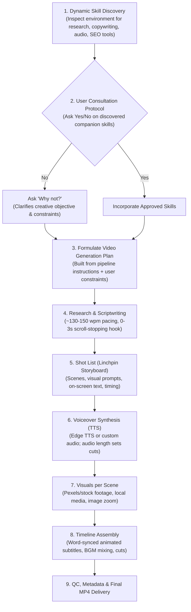

# Video Generation Skill

An agentic skill for turning any topic, script, or concept into a finished, polished video from the command line.

This skill structures the creative production process (briefing, research, scriptwriting, shot-listing) and executes assembly via the local `video` CLI tool ([MoneyPrinterTurbo](https://github.com/harry0703/MoneyPrinterTurbo)).

---

## The 8-Stage Topic-to-Video Pipeline



---

## Key Features

- **Dynamic Skill Discovery**: Does not assume any fixed plugins. Automatically inspects the agent's environment to find complementary skills (e.g. copywriting, hook scoring, audio cleanup, SEO).
- **User Consultation Protocol**: Before drafting the plan, the agent prompts the user with a simple Yes/No on candidate skills. If the user declines, it asks why to sharpen their creative goals and constraints.
- **Shot List Linchpin**: Bridges narrative copy with visual production using structured scene cards, visual cues, and duration anchors.
- **Edge TTS Integration**: Built-in access to high-quality, free Edge TTS voices in multiple accents and languages with zero API cost.
- **Local CLI Execution**: Drives timeline assembly, subtitle burning, audio mixing, and encoding locally via MoneyPrinterTurbo (`video`).

---

## Prerequisites & MoneyPrinterTurbo Setup

The skill requires **[MoneyPrinterTurbo](https://github.com/harry0703/MoneyPrinterTurbo)** to assemble and render video files.

### 1. Install System Dependencies (FFmpeg)

Ensure `ffmpeg` is installed and on your `PATH`:

```bash
# Ubuntu / Debian
sudo apt update && sudo apt install -y ffmpeg

# Arch Linux
sudo pacman -S ffmpeg

# macOS (Homebrew)
brew install ffmpeg

# Windows (winget)
winget install Gyan.FFmpeg
```

### 2. Install MoneyPrinterTurbo

Clone and set up MoneyPrinterTurbo:

#### Option A: Using `uv` (Recommended)
```bash
git clone https://github.com/harry0703/MoneyPrinterTurbo.git
cd MoneyPrinterTurbo
uv sync
```

#### Option B: Standard Python `venv`
```bash
git clone https://github.com/harry0703/MoneyPrinterTurbo.git
cd MoneyPrinterTurbo
python3 -m venv .venv
source .venv/bin/activate
pip install -r requirements.txt
```

### 3. Expose the `video` Command

To allow your AI agent (and terminal) to run `video` from any working directory, configure a wrapper or alias:

#### Wrapper script in `~/.local/bin` (Recommended):
```bash
cat << 'EOF' > ~/.local/bin/video
#!/usr/bin/env bash
exec /path/to/MoneyPrinterTurbo/.venv/bin/python /path/to/MoneyPrinterTurbo/cli.py "$@"
EOF
chmod +x ~/.local/bin/video
```
*(Make sure `~/.local/bin` is in your `$PATH`)*

#### Or add an alias to your `~/.bashrc` / `~/.zshrc`:
```bash
alias video="/path/to/MoneyPrinterTurbo/.venv/bin/python /path/to/MoneyPrinterTurbo/cli.py"
```

### 4. Configure `config.toml`

Copy the sample configuration file and add your credentials:
```bash
cp config.example.toml config.toml
```
- **Stock footage**: Add your free Pexels API key under `pexels_api_keys = ["YOUR_KEY"]`.
- **LLM Script generation (optional)**: Configure Ollama (`llm_provider = "ollama"`) or cloud LLM providers. Edge TTS voice synthesis requires no API key.

---

## Installing the `video-generation` Skill

### Method 1: Using the Install Script (Recommended)

Clone this repository and run `install.sh`:

```bash
git clone https://github.com/aakashdandekar2006/video-generation-skill.git
cd video-generation-skill
./install.sh
```

This symlinks the skill into:
- **Antigravity**: `~/.gemini/config/skills/video-generation`
- **Claude Code**: `~/.claude/skills/video-generation`
- **OpenAI Codex**: `~/.codex/skills/video-generation`
- **OpenCode**: `~/.config/opencode/skills/video-generation`

### Method 2: Claude Code Plugin / Marketplace

Add this repository as a marketplace or install directly in Claude Code:

```bash
/plugin marketplace add aakashdandekar2006/video-generation-skill
/plugin install video-generation
```

### Method 3: Manual Installation

Copy the `skills/video-generation` folder into your preferred agent's skills directory:

```bash
# Antigravity / Gemini CLI
cp -r skills/video-generation ~/.gemini/config/skills/

# Claude Code
cp -r skills/video-generation ~/.claude/skills/

# Codex
cp -r skills/video-generation ~/.codex/skills/

# OpenCode
cp -r skills/video-generation ~/.config/opencode/skills/
```

---

## Repository Structure

```text
video-generation-skill/
├── .claude-plugin/
│   ├── marketplace.json     # Marketplace manifest
│   └── plugin.json          # Plugin specification
├── skills/
│   └── video-generation/
│       └── SKILL.md         # The complete agent skill instructions
├── install.sh               # One-click multi-agent install script
├── .gitignore
├── LICENSE                  # Apache 2.0 License
└── README.md
```

---

## Usage Examples

Once installed, invoke the skill in conversation with your agent:

- *"Create a 9:16 short about 3 unexpected facts about deep-sea creatures."*
- *"Generate a 1-minute explainer on quantum computing using this script: [paste script]."*
- *"Assemble a video from my local clips './clip1.mp4,./clip2.mp4' with voiceover and animated subtitles."*

---

## License

Licensed under the [Apache License, Version 2.0](LICENSE).
