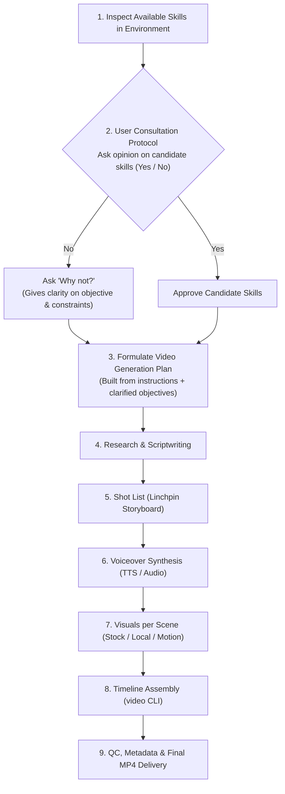

# Video Generation Skill (`video-generation`)

A complete, production-grade pipeline for transforming raw ideas and topics into finished, polished videos. Combines structured creative direction (briefing, research, scriptwriting, shot-listing) with local command-line assembly via the `video` command (MoneyPrinterTurbo CLI).

---

## Preflight Check 1: MoneyPrinterTurbo Availability

Before running the video generation pipeline, verify that MoneyPrinterTurbo is available:

1. **Check for the `video` command in PATH**:
   ```bash
   which video || command -v video
   ```
2. **If `video` is not found, locate MoneyPrinterTurbo's `cli.py`**:
   ```bash
   find ~ -name "cli.py" -path "*/MoneyPrinterTurbo/*" 2>/dev/null | head -n 1
   ```
   If found, invoke commands using that directory's Python interpreter and `cli.py`.

> [!IMPORTANT]
> If neither the `video` command nor MoneyPrinterTurbo's `cli.py` can be located, **stop and prompt the user to install MoneyPrinterTurbo first**:
>
> *"MoneyPrinterTurbo is required for video assembly and rendering, but was not found on your system. Please install it first from https://github.com/harry0703/MoneyPrinterTurbo before proceeding with video generation."*

---

## Preflight Check 2: Ollama Service Status (If using Local LLM)

If script generation is configured to use a local or cloud Ollama model, verify whether the Ollama service/process is active:

```bash
systemctl is-active --quiet ollama || pgrep -x ollama > /dev/null
```

> [!IMPORTANT]
> If Ollama is needed but **not running**, stop and prompt the user to start the service:
>
> *"The Ollama service is not currently running. Please start it by running:"*
> ```bash
> sudo systemctl start ollama
> ```
> *(Also ensure `ollama signin` has been completed if using Ollama Cloud models).*

---

## Preflight Check 3: Dynamic Skill Discovery & Planning

**Do not hardcode or assume any specific external skills are installed on the agent.** Other environments or users will have different sets of skills.

Instead, dynamically inspect the environment, identify any installed skills that could assist the video pipeline, and synthesize the findings into a **Video Generation Plan**.

### 1. Locate and Inspect Available Skills
Navigate and inspect the agent's installed skills directory or configuration. Identify any skills capable of assisting with:
- **Research & Ideation**: Topic discovery, factual research, domain analysis, or literature lookup.
- **Copywriting & Scripting**: Hook formulation, creative writing, script review, or persona/voice profiling.
- **Audio & Speech**: Audio cleaning, transcript analysis, silence trimming, or custom TTS.
- **Visuals & Assets**: Code snippet rendering, UI walkthroughs, diagrams, or image generation.
- **Packaging & SEO**: Title/thumbnail evaluation, search metadata, or video chapter generation.

### 2. User Consultation Protocol (Before Planning)
**Before creating the Video Generation Plan**, present any discovered relevant skills to the user to get their opinion:
1. **Ask a simple Yes/No**:
   > *"I found the installed skill **`<skill-name>`** which can help with [specific task, e.g., hook scoring / audio cleaning / chaptering]. Would you like me to use it for this video? (Yes / No)"*
2. **If Yes**:
   Mark the skill as approved to be included in the generation plan.
3. **If No**:
   **Ask why**:
   > *"Understood. Could you share why you prefer not to use it?"*
   - **Why this matters**: Asking "why not" uncovers vital creative constraints and sharpens the core objective (e.g., *"I already wrote the exact script"*, *"I want a serious documentary tone, not fast-paced hooks"*, *"Keep the natural pauses in my audio"*).
   - Use their answers to gain direct clarity on their goals before drafting the plan.

### 3. Formulate the Video Generation Plan
Once the user consultation is complete, formulate a tailored **Video Generation Plan** based on the instructions in this skill, the user's clarified objectives/constraints, and the approved skills:
1. **Creative Brief**: Audience, target platform, duration, aspect ratio, and tone (reflecting constraints gathered during consultation).
2. **Approved Skills Included**: Specific tools/skills the user opted into and how they will be used.
3. **Script & Storyboard Approach**: Hook strategy, core beats, and planned shot list structure.
4. **Media & Audio Sourcing**: Voiceover voice (Edge TTS vs. local audio), BGM volume, and visual assets (local footage vs. stock).
5. **Timeline Assembly**: Pacing, subtitle animation, transitions, and final render specifications.

---

## The Topic-to-Video Pipeline



---

## Step-by-Step Pipeline Instructions

### 1. Clarify the Brief
Before generating code or media, pin down the creative parameters. If not explicitly provided by the user, infer sensible defaults based on the topic and platform:
- **Audience**: Who is watching? (General public, students, developers, buyers)
- **Voice & Tone Profile**: Check if the user has provided a style guide, tone preferences, or persona constraints.
- **Target Duration**:
  - *Short-form*: 15s–60s (TikTok, IG Reels, YouTube Shorts)
  - *Mid-form*: 1–3 min (Product demos, quick explainers)
  - *Explainer*: 3–5 min (Deep-dives, tutorials)
- **Aspect Ratio**:
  - `9:16` (Vertical for mobile / Reels / Shorts / TikTok) — *default*
  - `16:9` (Horizontal for YouTube / desktop / presentations)
  - `1:1` (Square for Instagram / LinkedIn feed posts)
- **Tone**: Casual, energetic, authoritative, narrative, or humorous.
- **Platform**: Determines pacing, font sizes, caption styling, and hook intensity.

### 2. Research the Topic
Gather verified facts, compelling hooks, and accurate data points:
- **Factual / Current Events**: Use search tools to verify dates, statistics, proper names, and core claims.
- **Evergreen / Conceptual**: Structure 3–5 surprising or high-value insights.
- **Identify the Hook**: The single most intriguing angle to grab attention within the first 3 seconds (leveraging any research/ideation skills approved in the plan).

### 3. Write the Script
Draft narration formatted specifically for spoken audio, not reading:
- **Rule of Thumb Pacing**: ~130–150 words per minute (~2.2 to 2.5 words per second). A 30-second short needs ~65–75 words; a 60-second video needs ~130–150 words.
- **Hook Validation**: Stop the scroll immediately in the first 3 seconds. If any hook evaluation or copywriting tools were approved by the user, run candidate hooks through them before finalizing.
- **Structure**:
  1. *Hook (0–3s)*: Stop the scroll immediately with a bold question or surprising statement.
  2. *Body (3–5 beats)*: Progress logically through core points. Use punchy sentences without dense dependent clauses.
  3. *Close / CTA (final 3–5s)*: Clear takeaway or call-to-action.
- Avoid markdown formatting, emojis, parentheticals, or citations inside the spoken narration text.

### 4. Break the Script into a Shot List (The Linchpin)
The shot list bridges the script with visual and audio generation. Split the script into scenes (typically 3–6 seconds each).

> [!IMPORTANT]
> **The Shot List is the most critical artifact.** When scene text, visual descriptions, and timing are well-structured, downstream generation and assembly become seamless and deterministic.

#### Shot List Template:
| Scene # | Narration Line | Visual Description / Search Terms | On-Screen Text | Est. Duration |
| :--- | :--- | :--- | :--- | :--- |
| 1 (Hook) | "Deep beneath the ocean, creatures create their own light." | Bioluminescent jellyfish glowing in pitch black deep sea | DEEP SEA SECRETS | 4s |
| 2 (Beat 1) | "Over 75% of deep-sea animals produce bioluminescence." | Glowing anglerfish lure moving in the dark | 75% OF CREATURES | 4s |
| 3 (Beat 2) | "They use chemical reactions to communicate, hunt, and camouflage." | Macro shot of glowing blue photophores pulsing on squid | NATURAL GLOW | 5s |
| 4 (Close) | "Follow to uncover more secrets hidden in the abyss." | Submersible light illuminating underwater trench cliff | EXPLORE MORE | 3s |

### 5. Generate the Voiceover
Synthesize speech from the narration.
- **Timing Authority Rule**: The **actual** duration of generated audio files (not the estimated duration from step 4) becomes the definitive timeline anchor for scene pacing and visual cuts.
- In unified execution, the `video` command handles TTS automatically via Edge TTS (free, high quality).
- For custom voiceovers or pre-recorded audio, clean the audio (using any approved audio cleaning skills) and supply `--custom-audio-file <path>`.

### 6. Source or Generate Visuals per Scene
Match visuals to the exact duration of each scene's audio:
- **Stock Footage**: Pexels, Pixabay, or Coverr clips matched to scene keywords.
- **Local Media**: Video clips or images provided via `--video-source local --video-materials "clip1.mp4,clip2.mp4"`.
- **Image Motion**: When stills are used, apply dynamic motion (`--image-motion zoom`) to maintain viewer engagement.

### 7. Assemble the Timeline
Stitch audio, video, subtitles, and music together:
- Concatenate footage according to scene order (`--video-concat-mode sequential` or `random`).
- Overlay animated word-synced subtitles (`--subtitle-display-mode word_by_word`).
- Mix background music (BGM) under the narration at an unobtrusive level (`--bgm-volume 0.15`–`0.2`).
- Apply scene transitions (`--video-transition-mode fade-in`, `slide-in`, etc.).

### 8. Render, Review, and Quality Check (QC)
Run a QC inspection before delivering the final video:
- [ ] **Timing & Sync**: Does the visual change align with the voiceover topic?
- [ ] **Legibility**: Are subtitles readable against the background? (Checked font size, contrast, stroke).
- [ ] **Audio Mix**: Is the voice clear over the background music?
- [ ] **Safe Zones**: In `9:16` vertical videos, are UI overlays (like TikTok/Reels buttons) clear of critical text?
- [ ] **Companion Metadata (Optional)**: If requested or approved in the plan, generate companion upload metadata (e.g. titles, tags, descriptions, or chapter timestamps).

---

## Command Execution & Task Outputs

The pipeline is driven by MoneyPrinterTurbo (`video` command or `python cli.py`):
- **Command Invocation**: Run via `video` (if installed in PATH or aliased) or directly using the environment's Python interpreter with `cli.py`:
  ```bash
  video [options]
  # OR
  python cli.py [options]
  ```
- **Configuration**: Configured via `config.toml` inside the MoneyPrinterTurbo directory (contains API keys, TTS defaults, and LLM providers).
- **Task Output Structure**: Task outputs are written inside MoneyPrinterTurbo's `storage/tasks/<task_id>/`:
  - Final video: `storage/tasks/<task_id>/final-1.mp4`
  - Voiceover track: `storage/tasks/<task_id>/audio.mp3`
  - Subtitle file: `storage/tasks/<task_id>/subtitle.srt`
  - Script data: `storage/tasks/<task_id>/script.json`
- **Bundled Resources**:
  - Fonts: Stored in `resource/fonts/` (e.g. `STHeitiMedium.ttc`, `MicrosoftYaHeiNormal.ttc`, `BeVietnamPro-Bold.ttf`, `Charm-Bold.ttf`).
  - Music: Stored in `resource/songs/` (e.g. `output000.mp3` to `output029.mp3`).

---

## Execution Modes with `video`

### Mode A: End-to-End Orchestration (Recommended)
The agent drafts the script, plans the shot list, and executes the complete video render in one command:

```bash
video \
  --video-script "Deep beneath the ocean, creatures create their own light. Over 75 percent of deep-sea animals produce bioluminescence to hunt, mate, and survive in eternal darkness. Subscribe to dive deeper into the abyss." \
  --video-terms "bioluminescence,deep sea jellyfish,ocean abyss,underwater glowing" \
  --video-aspect 9:16 \
  --voice-name en-US-ChristopherNeural \
  --voice-rate 1.05 \
  --subtitle-display-mode word_by_word \
  --subtitle-animation pop_spring \
  --bgm-type random \
  --bgm-volume 0.15 \
  --video-source pexels
```

### Mode B: Staged / Phased Execution (`--stop-at`)
Use `--stop-at` to inspect or iterate on intermediate assets without rendering the full video:

1. **Generate or test script only**:
   ```bash
   video --video-subject "Origin of Coffee" --stop-at script
   ```
2. **Generate and inspect voiceover audio**:
   ```bash
   video --video-script "Your script here" --voice-name en-US-JennyNeural --stop-at audio
   ```
3. **Generate subtitles**:
   ```bash
   video --video-script "Your script here" --stop-at subtitle
   ```
4. **Download / inspect footage**:
   ```bash
   video --video-script "Your script here" --video-source pexels --stop-at materials
   ```

### Mode C: Assembling Local Assets & Screen Recordings
When the user has recorded clips, slides, or local images:
```bash
video \
  --video-script "Here is a quick overview of our new feature release. First, notice the updated dashboard. Next, review the live analytics." \
  --video-source local \
  --video-materials "./slide1.png,./screen_recording.mp4,./slide2.png" \
  --image-motion zoom \
  --video-aspect 16:9 \
  --video-transition-mode fade-in \
  --voice-name en-US-GuyNeural
```

---

## Common Edge TTS Voices Catalog

| Voice Name | Language / Locale | Gender | Style / Best For |
| :--- | :--- | :--- | :--- |
| `en-US-ChristopherNeural` | English (US) | Male | Authoritative, energetic, explainers |
| `en-US-JennyNeural` | English (US) | Female | Warm, conversational, tutorials |
| `en-US-GuyNeural` | English (US) | Male | Natural, casual storytelling |
| `en-US-AriaNeural` | English (US) | Female | Professional, news, announcements |
| `en-GB-SoniaNeural` | English (UK) | Female | Elegant, documentary, British accent |
| `en-GB-RyanNeural` | English (UK) | Male | Documentary, crisp, polished |
| `es-ES-AlvaroNeural` | Spanish (Spain) | Male | Standard Spanish narration |
| `zh-CN-XiaoxiaoNeural-Female` | Chinese (Mandarin) | Female | Expressive, default Chinese voice |
| `no-voice` | None | N/A | Silent video (subtitles & music only) |

---

## Quick Reference CLI Options

| Flag | Values / Syntax | Purpose |
| :--- | :--- | :--- |
| `--video-script` | `"text"` | Narration script (skips LLM generation) |
| `--video-subject` | `"topic"` | Topic prompt for LLM script generation |
| `--video-terms` | `"term1,term2"` | Search terms for stock footage |
| `--video-aspect` | `9:16`, `16:9`, `1:1` | Aspect ratio |
| `--video-source` | `pexels`, `pixabay`, `coverr`, `local` | Source for visual clips |
| `--video-materials` | Comma-separated paths | Files used when `--video-source local` |
| `--voice-name` | Voice identifier or `no-voice` | Edge TTS voice |
| `--voice-rate` | Float (`0.8` to `1.5`) | Speech pacing multiplier |
| `--voice-volume` | Float (`0.5` to `2.0`) | Voiceover audio gain |
| `--bgm-type` | `random`, `none`, `custom` | Background music mode |
| `--bgm-file` | Filename in `resource/songs/` | Specific background music track |
| `--bgm-volume` | Float (`0.1` to `0.3`) | BGM audio level |
| `--subtitle-display-mode`| `word_by_word`, `sentence` | Subtitle animation timing |
| `--subtitle-position` | `bottom`, `two_thirds_bottom`, `center` | Vertical placement of captions |
| `--video-clip-duration`| Integer seconds (default: 5) | Max length before cutting to next clip |
| `--video-transition-mode` | `none`, `fade-in`, `fade-out`, `shuffle` | Transition between scenes |
| `--stop-at` | `script`, `audio`, `subtitle`, `materials`, `video` | Stop execution after specified phase |

---

## Output Validation & Delivery

When execution completes successfully:
1. The tool prints a JSON summary to stdout:
   ```json
   {"task_id": "...", "result": {"videos": ["<output_path>/storage/tasks/<task_id>/final-1.mp4"]}}
   ```
2. Verify the generated MP4 file exists and report the absolute path to the user.
3. If an iteration is required (e.g. adjust speech rate or swap a term), rerun with the adjusted flags rather than rebuilding from scratch.
